# BILLIONAIRES-WEALTH-INTELLIGENCE-SQL-ANALYSIS
## A SQL Investigation of the World's 200 Richest People

### INTRODUCTION

This project examines the distribution of wealth among the 200 individuals listed in the supplied Top 200 Richest Person in the World dataset. The analysis uses SQL queries to explore billionaire rankings, age, country representation, industry concentration and net worth. The purpose is to turn the supplied records into findings that can support a clear understanding of where billionaire wealth is concentrated and how the listed individuals are distributed across demographic and economic groups.

In total the dataset records US$6,368.5 billion of wealth. The report answers the ten business questions set in the project brief and adds three supporting analyses that test how reliable the headline averages are.

### BUSINESS SCENARIO AND OBJECTIVES
The project brief places the analyst in the role of a Junior Data Analyst working for a global financial research organisation. The organisation wants to understand wealth distribution among the world's 200 richest people. The analysis therefore addresses the ten business questions stated in the project brief and adds five supporting analyses to provide further context.

### DATASET DESCRIPTION
The supplied CSV contains 200 records and seven fields: serial_number, rank, name, age, country, net worth billion US dollars and industry. Net worth is expressed in billions of US dollars. The initial data inspection found no missing values in the seven columns. The numeric fields were recognised as integer or decimal values, while name, country and industry were treated as text.

Data quality note: the analysis uses the dataset as supplied. The project brief describes the source as a Forbes-based list, but the supplied files do not state a precise valuation date or provide a separate data dictionary with source-level verification. Results was therefore be interpreted as findings from this particular dataset rather than as a live ranking.

### METHODOLOGY AND SQL ENVIRONMENT
The CSV was loaded into a table named billionaires and analysed using SQLite-compatible SQL. The SQL statements were executed against the supplied records to validate the outputs. The project uses SELECT, ORDER BY, LIMIT, aggregate functions (COUNT, SUM and AVG), GROUP BY, HAVING, WHERE, CASE and a scalar subquery. The supplied SQL script contains the complete set of statements. The results workbook contains the source data and the output of each query.

## SQL RESULTS AND INTERPRETATION

### The 20 richest billionaires

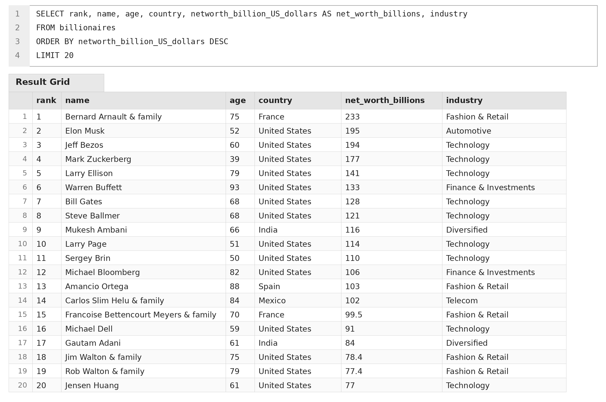
Finding: Bernard Arnault & family lead with US$233.0 billion, US$38.0 billion ahead of Elon Musk in second place. 14 of the top 20 are from the United States and 9 of the 20 made their wealth in Technology. Together the top 20 hold US$2,480.3 billion.

### The five youngest billionaires

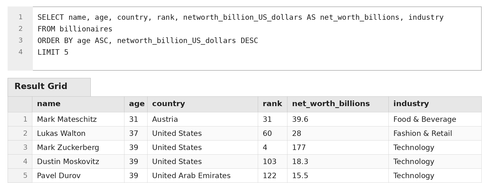
Finding: Mark Mateschitz of Austria is the youngest at 31, followed by Lukas Walton at 37. Three billionaires are aged 39 and the last three places go to them, so the net worth tie-breaker ranks Mark Zuckerberg ahead of Dustin Moskovitz and Pavel Durov. Zuckerberg, with US$177.0 billion, is the only one of the five in the global top 5.

### Average age and average net worth

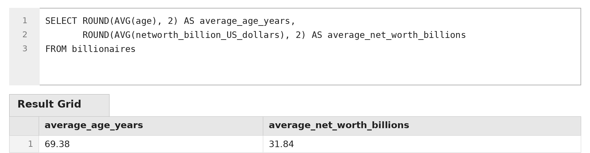
Finding: The average billionaire is 69.4 years old with a net worth of US$31.84 billion. The mean is well above the median net worth of US$19.25 billion (Section 6.1), so a small number of very large fortunes pulls the average upward.

### Five most represented countries

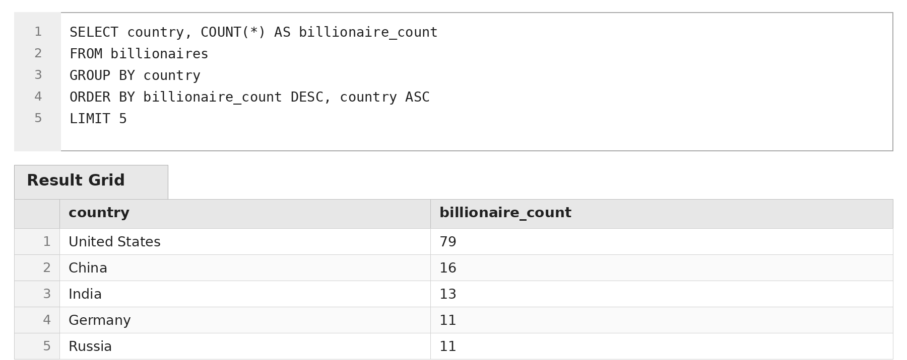
Finding: The United States has 79 billionaires, more than four times China, which is second with 17. Germany and Russia tie on 11 for fourth place. The five countries together account for 131 of the 200 billionaires (65.5%).

### Combined net worth by country

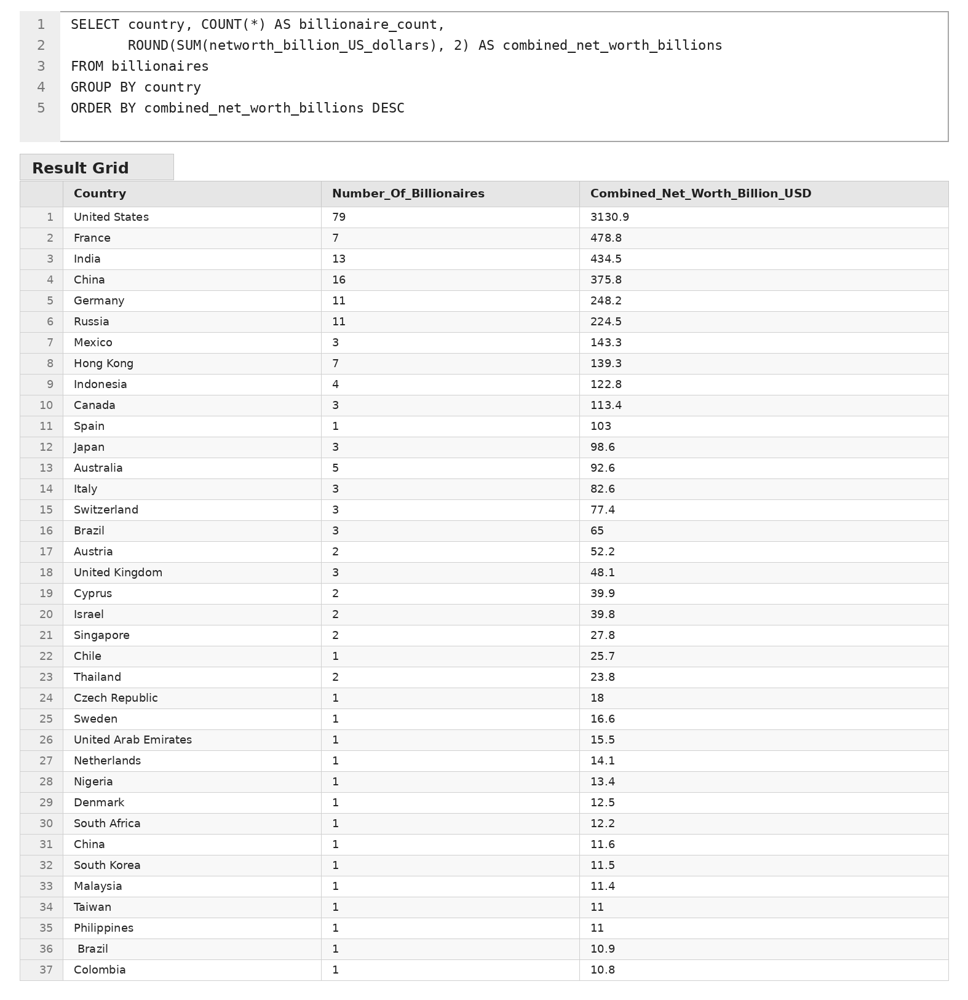
Finding: The United States holds US$3,130.9 billion, which is 49.2% of the US$6,368.5 billion held by all 200 billionaires. France ranks second by wealth (US$478.8 billion) with only 7 billionaires, because two entries, Bernard Arnault & family and Francoise Bettencourt Meyers & family, account for US$332.5 billion. India has more billionaires than France (13 against 7) but a lower combined net worth. China ranks fourth, with US$387.4 billion.

### The five industries with the highest number of billionaires

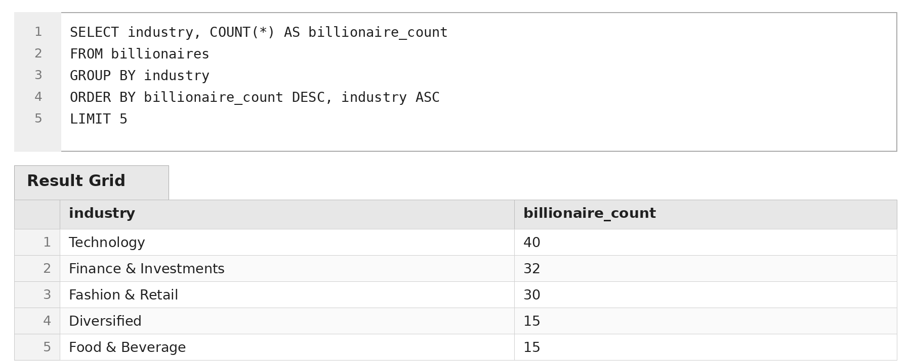
Finding: Technology leads with 40 billionaires, followed by Finance & Investments (32) and Fashion & Retail (30). These three industries contain 102 of the 200 billionaires (51.0%). Diversified and Food & Beverage tie on 15 for fourth place, and the next industry, Metals & Mining, has 12, so the top five is unambiguous.

### Countries with at least five billionaires

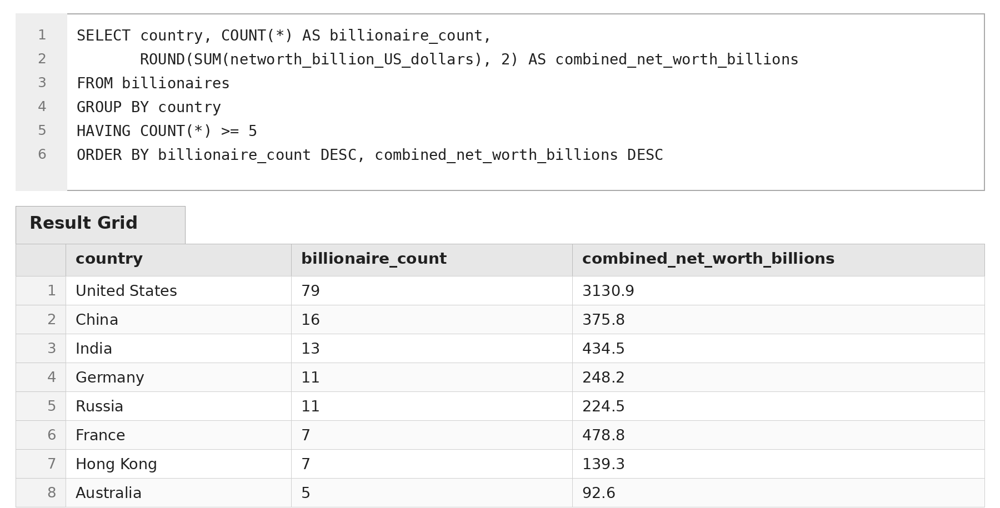
Finding: Eight of the 35 countries reach the threshold, and together they account for 150 billionaires (75.0% of the list). Australia is included with exactly 5 because HAVING COUNT(*) >= 5 keeps groups of five. Hong Kong is recorded separately from China in the source, so its 7 billionaires are not counted in China's 17.

### Total wealth of billionaires younger than 50

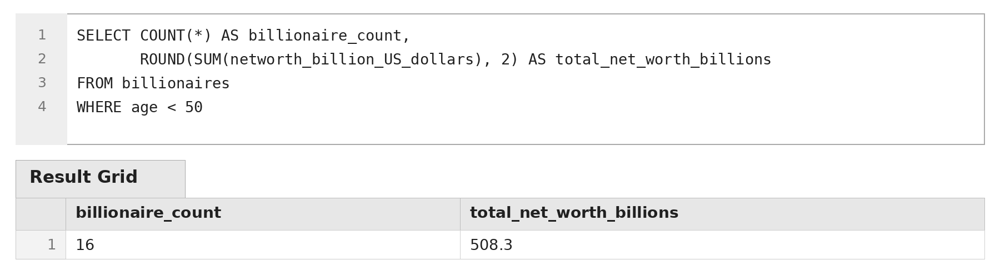
Finding: 16 billionaires are under 50 and they hold US$508.3 billion, which is 8.0% of all wealth on the list. Mark Zuckerberg alone accounts for US$177.0 billion of that, or 34.8% of the under-50 total.

### Billionaires whose net worth exceeds the overall average

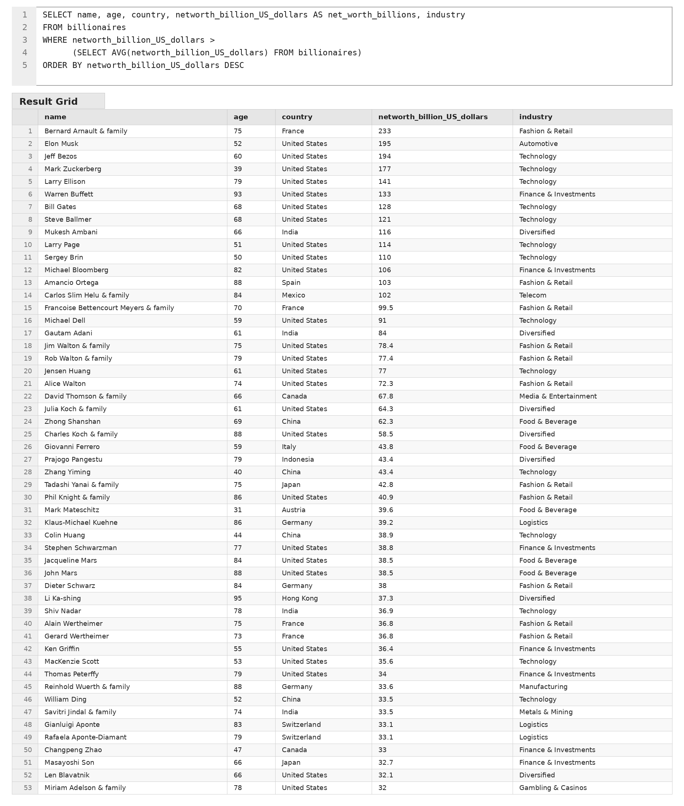
Finding: 53 of 200 billionaires (26.5%) have a net worth above the average of US$31.84 billion. They hold US$3,841.7 billion, or 60.3% of the total. The cut-off falls just after Miriam Adelson & family (US$32.0 billion, rank 53). The other 147 billionaires, from US$31.6 billion down to US$10.7 billion, are below the average.

### The industry with the highest average net worth

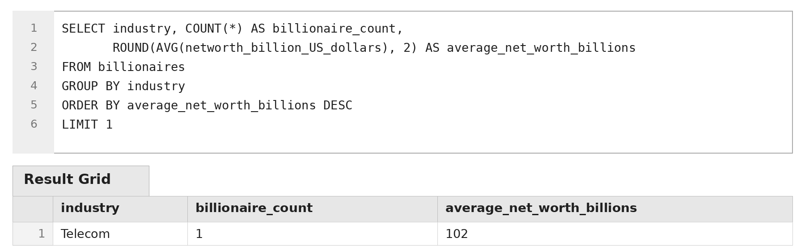
Finding: On the raw average, Telecom comes first at US$102.00 billion, but it represents one person (Carlos Slim Helu & family), so it says little about the industry. Among industries with at least five billionaires, Technology has the highest average at US$43.47 billion, ahead of Fashion & Retail (US$38.85 billion) and Diversified (US$38.61 billion).

### Overall wealth and population summary

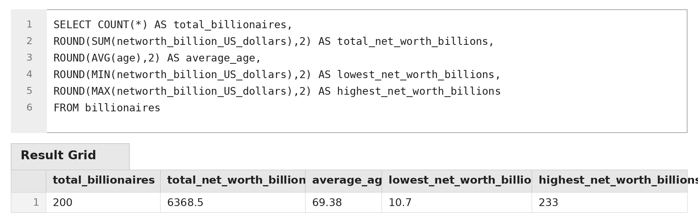
Overall wealth and population summary
The dataset holds 200 billionaires with a combined net worth of US$6,368.5 billion. The average age is 69.38 years. Net worth ranges from US$10.7 billion to US$233.0 billion, so the richest person holds about 22 times as much as the person ranked 200th.

### Wealth concentration by industry

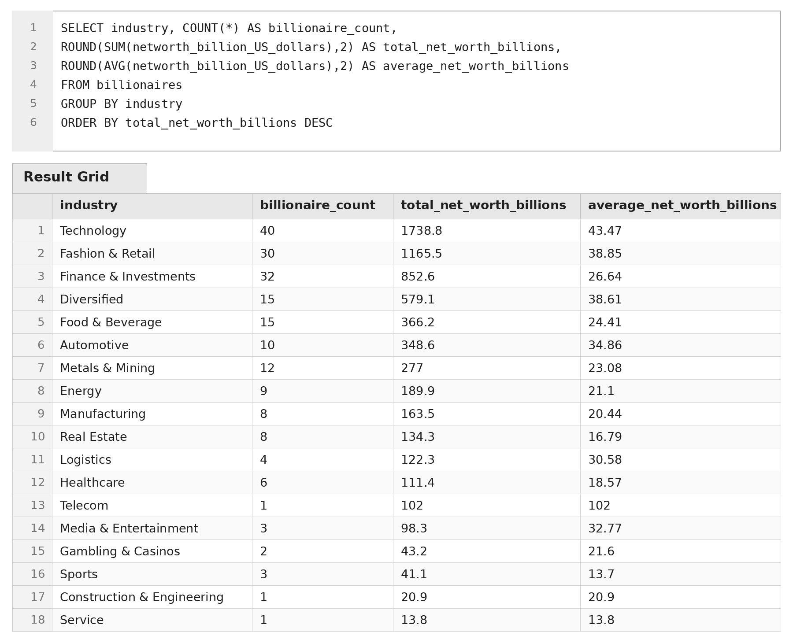
- Technology leads on wealth with US$1,738.8 billion from 40 billionaires. That is 27.3% of all wealth on the list, and it has the highest average among industries with at least five people (US$43.47 billion).
- Fashion & Retail ranks second with US$1,165.5 billion (18.3%). It has fewer billionaires than Finance & Investments (30 against 32) but about 37% more wealth, because its average is higher (US$38.85 billion against US$26.64 billion).
- The top three industries together (Technology, Fashion & Retail, and Finance & Investments) hold 59.0% of all wealth.
- Telecom’s average of US$102.0 billion comes from one person, so it shouldn’t be read as an industry trend.
- Eighteen industries are represented, and the smallest (Construction & Engineering and Service) have one billionaire each.

### Billionaires by age group

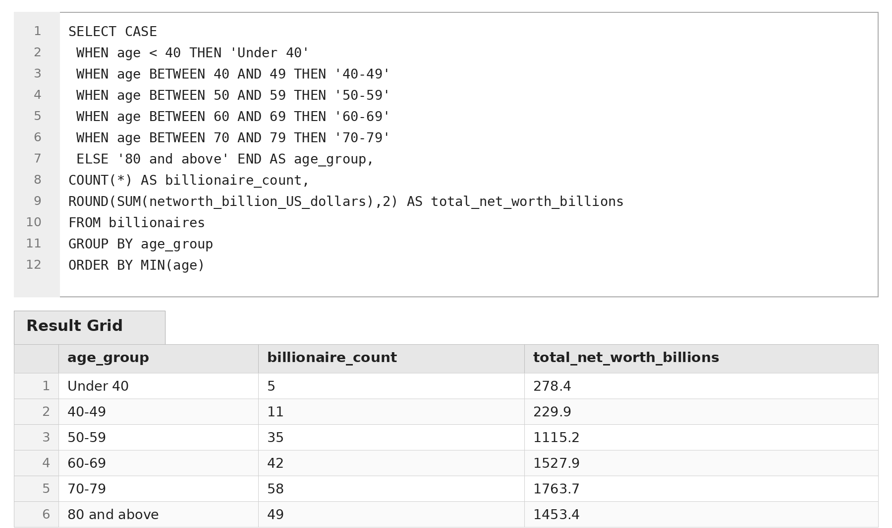
- The 70 to 79 group is the largest, with 58 billionaires and US$1,763.7 billion.
- Billionaires aged 70 and over number 107 (53.5% of the list) and hold US$3,217.1 billion (50.5% of wealth).
- Only 16 billionaires are under 50. They hold US$508.3 billion, which is 8.0% of the total.
- The under-40 group has the highest average, about US$55.7 billion per person, but it has only 5 people. Mark Zuckerberg’s US$177.0 billion makes up about 64% of that group’s total, so this reflects one person.

### Share of wealth held by the top 10

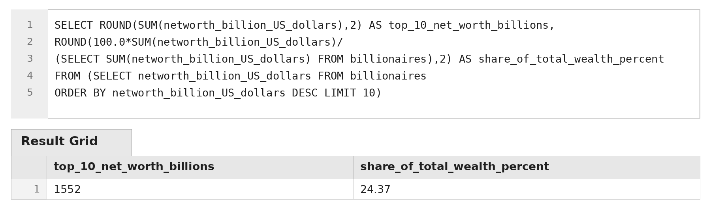
The ten richest people hold US$1,552.0 billion, or 24.37% of the total. That is 5% of the billionaires holding nearly a quarter of the wealth. Their average of US$155.2 billion is about 4.9 times the overall average of US$31.84 billion.

## DASHBOARD ANALYSIS
### Billionaire Wealth Intelligence – Interactive SQL Analysis Dashboard

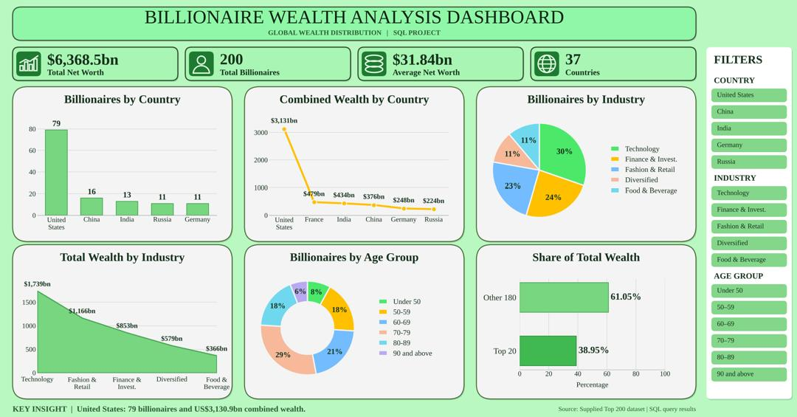
The Billionaire Wealth Analysis Dashboard provides an interactive visual exploration of the wealth distribution of the world's 200 richest individuals. Developed as part of an SQL data analytics project, the dashboard uses data-driven visualisations to examine billionaire representation across countries, industries and age groups.

The dashboard highlights key performance indicators, including total net worth of US$6,368.5 billion, a total of 200 billionaires, average net worth of US$31.84 billion, and representation across 37 countries.

### Key Areas of Analysis

- Billionaires by Country: Examines the distribution of billionaires across countries, with the United States recording the highest representation at 79 individuals.

- Combined Wealth by Country: Compares the total net worth associated with selected countries, highlighting the United States as the leading country.

- Billionaires by Industry: Shows how billionaires are distributed across major industries, including Technology, Finance & Investments, Fashion & Retail, Diversified, and Food & Beverage.

- Total Wealth by Industry: Identifies the industries contributing the largest share of combined billionaire wealth.

- Billionaires by Age Group: Explores the age distribution of billionaires across six age categories.

- Share of Total Wealth: Compares the wealth held by the top 20 billionaires against the remaining 180 individuals.

### Interactive Features

The dashboard includes filters for Country, Industry and Age Group, allowing users to explore different segments of the dataset and examine patterns in billionaire wealth distribution.

### Key Insight

The United States dominates the dataset, accounting for 79 billionaires with a combined net worth of approximately US$3,130.9 billion. Technology is the leading industry by both billionaire representation and total wealth contribution. Furthermore, the top 20 richest individuals account for 38.95% of the total recorded wealth.

### Project Objective

*The objective of this project is to demonstrate how SQL-based data analysis and interactive dashboard visualisation can transform raw billionaire wealth data into meaningful insights that support data interpretation, comparison and informed decision-making.*

## KEY FINDINGS

- The dataset contains 200 billionaire records and a combined recorded net worth of US$6,368.5 billion.
- The United States has the strongest representation, with 79 of the 200 individuals, and the highest combined wealth.
- Technology is the most common industry by number of billionaires, with 40 individuals.
- Sixteen billionaires are younger than 50, with combined net worth of US$508.3 billion.
- The top ten individuals account for 24.37% of the total net worth in the dataset.
- Telecom has the highest average net worth by industry, but the result is based on a single individual and should be treated cautiously.
  
## RECOMMENDATIONS

- Use country-level counts and combined net worth together when assessing geographic wealth concentration; a high number of individuals does not always mean the same ranking in combined wealth.
- Give particular attention to the technology, finance and fashion industries because they contain the largest numbers of billionaires in this dataset.
- Treat average net worth by industry cautiously when an industry has very few records. Always report the number of individuals alongside the average.
- Use age-band analysis as a supporting demographic measure, while avoiding assumptions that age alone explains wealth creation.
- For future updates, record the dataset's publication date, valuation date and source link so that comparisons across years can be made consistently.
- Consider extending the project with year-on-year data, inflation-adjusted wealth, regional groupings and changes in rank if comparable historical datasets become available.
  
## LIMITATIONS

The analysis is limited to the 200 rows and seven columns in the supplied CSV. It is a snapshot rather than a time series, and it does not include historical net worth, business ownership details, debt, liquidity, family-level methodology or currency conversion assumptions. The project brief does not specify the exact valuation date. Findings describe the supplied file and should not be interpreted as current real-time wealth estimates.

## CONCLUSION
The SQL analysis provides a structured view of wealth distribution among the 200 individuals in the supplied dataset. It shows that billionaire representation and combined net worth are concentrated in a small number of countries, with the United States clearly leading. Technology is the most represented industry, while the top ten individuals hold nearly one-quarter of the total wealth recorded. The project demonstrates how SQL filtering, sorting, grouping and aggregation can turn a raw dataset into evidence that supports business interpretation and further research.

*BY ABDUl-LATIF FUSHEINI*
